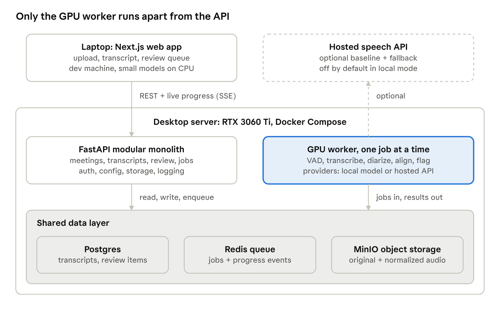

# Meeting-to-Engineering Copilot

Turns customer meetings into evidence-backed engineering decisions: a trustworthy transcript
first, then detected feature requests, then investigation against the real codebase. Every
claim links back to who said it and when.

**Status:** Stage 1, Milestone 1 (skeleton) in progress.

## What's here

| Path | What it is |
| --- | --- |
| [`specs/stage-1/spec.md`](specs/stage-1/spec.md) | Stage 1 spec: scope, architecture, data model, evaluation, testing |
| [`specs/stage-1/milestone-1.md`](specs/stage-1/milestone-1.md) | Current milestone, task by task |
| [`docs/decisions/`](docs/decisions/) | Architecture decision records (ADRs) |
| [`CLAUDE.md`](CLAUDE.md) | Conventions and rules for AI-assisted development in this repo |

## Architecture



## Quick start

Coming in Milestone 1:

```bash
docker compose up
```
