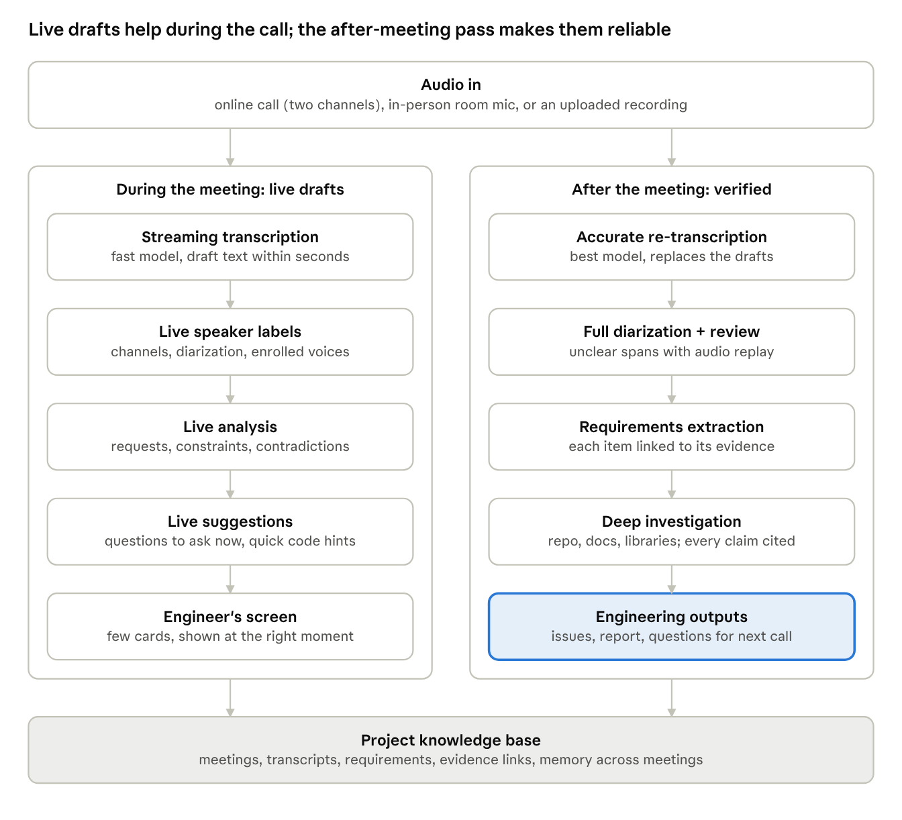
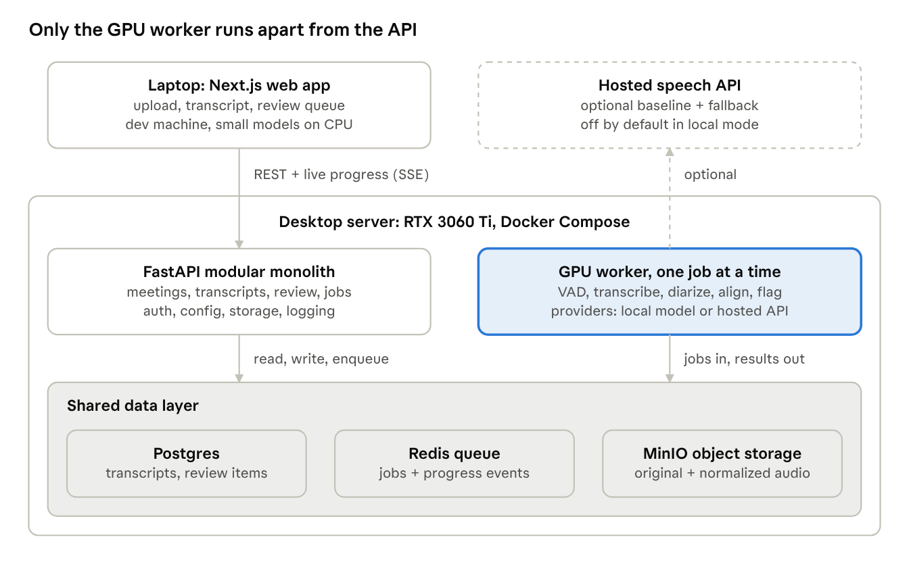
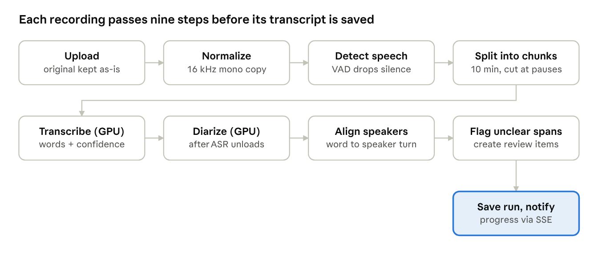

# Meeting-to-Engineering Copilot — Stage 1 Spec

As of 2026-11-19 · Author: Aymen

## Overview

Stage 1 turns an uploaded meeting recording into a trustworthy, replayable record: who said what, when, and which words the system was unsure about. Every later stage builds on this record, so its data model must already support tracing any future AI claim back to a speaker, a transcript segment and an audio timestamp.

The product vision: a copilot that turns customer conversations into evidence-backed engineering decisions. It understands what a customer asked for, investigates the request against the real codebase, and drafts scoped, traceable work items. The AI recommends; the engineer or customer validates.

**Roadmap** (each stage ships as a usable product on its own):

1. **Meeting record** (this spec): upload, diarized transcript, flagged unclear segments with replay, full storage. Built streaming-ready from day one, and the accuracy reference live mode is measured against.
2. **Live transcript**: draft text within seconds, online and in-person, replaced by verified text after the meeting.
3. **Live analysis**: feature requests, constraints and contradictions detected during the call, with the clarifying question to ask right now.
4. **Codebase-aware investigation**: quick hints live ("a similar module exists"), full evidence-backed report and draft GitHub issues after the meeting.
5. **Cross-meeting memory**: a project knowledge base and contradiction detection between meetings.
6. **Multilingual depth**: French / English / Tunisian Derja code-switching as a measured, first-class feature (runs alongside every stage).

## Full product pipeline

The finished app runs two paths over the same audio. The live path favours speed and gives the engineer drafts and suggestions during the call. The after-meeting path favours accuracy, replaces the drafts, and produces the work items people act on.



Both paths write into one knowledge base, so every requirement, suggestion and report links back to the exact words, speaker and audio moment it came from. Live detections are passed to the after-meeting extraction as hints, and the gap between the two paths is itself measured.

## How each part is measured

Every box in the pipeline gets a number, measured on a fixed test set and re-run on every change. Targets are starting guesses, to be reset once the first benchmark shows what is realistic.

| Part | Metric | How it is measured | Target (starting guess) |
| --- | --- | --- | --- |
| Accurate transcription | WER, CER per dataset | Against human transcripts: AMI, TunSwitch, LinTO, own calls | Beat the plain Whisper baseline on every dataset |
| Streaming transcription | Delay (median, 95th percentile); accuracy gap vs. offline | Same audio run both ways, timestamps compared | Median under 3 s; WER within 5 points of offline |
| Speaker labels | DER; live labels that change after the meeting | AMI speaker references; own calls | Report per mode: online, in-person, upload |
| Unclear spans | Recall of real errors; flags per hour | Flags compared with words the transcript got wrong | At least 70% recall, under 30 flags per hour |
| Request detection | Precision, recall, detection delay | Requests you labelled in 15 scripted calls | Recall 85%, precision 70%, under 15 s live |
| Clarifying questions | Usefulness, 1–5 | 2–3 people rate them without knowing which system wrote them | Average 4 or higher |
| Investigation | Valid citations; correct conclusions | Script checks every cited file, line or timestamp exists; human rubric on 20 requests | 100% valid citations; 80% judged correct |
| System | Real-time factor, peak VRAM, recovery | Benchmark runs; kill the worker mid-job | Live mode keeps up with speech; no lost work |

## How good it will realistically be

- **Clear English, online calls:** strong. Modern models handle this well; the channel split makes speaker labels reliable.
- **In-person, one room mic:** noticeably weaker. Distance, echo and people talking over each other raise errors, and live speaker labels will often need the after-meeting correction.
- **Tunisian Derja with French and English:** the hardest case. Published results show plain Whisper above 50% WER on Derja and the best public fine-tune around 32%. Expect many review flags here; that is exactly what the unclear-span review is for.
- **Live analysis:** good at explicit requests ("we need X"), weaker at implied ones ("it's annoying when…"). The after-meeting pass catches more.
- **Investigation:** only as good as the repo and docs it can read. When evidence is missing it must say so instead of guessing; that honesty is part of the quality bar.

## Scope

Stage 1 handles recorded meetings only; nothing is analysed for meaning yet.

**In scope**

- Upload of audio or video files (wav, mp3, m4a, mp4, webm), up to 3 hours
- Speech detection, chunking, transcription with word-level timestamps and confidence
- Speaker diarization, with speakers renameable by the user
- Unclear-segment detection, with a review queue and one-click audio replay
- Full storage of original audio, transcript and every processing run
- Configurable speech providers (local GPU or hosted API)
- A benchmark harness and a published evaluation report

**Out of scope** (later stages)

- Feature-request extraction, summaries, any LLM analysis
- Live meetings, Zoom / Meet / Teams integrations
- GitHub, Jira, or web research
- Multi-tenant SaaS billing

**Definition of done**

- [ ] `docker compose up` on a fresh machine runs the full stack
- [ ] A 60-minute meeting processes end to end without manual steps
- [ ] Clicking any word plays the audio at that moment
- [ ] Evaluation report published with numbers for at least 3 speech models on 3 datasets
- [ ] Worker survives a crash mid-job and resumes or retries cleanly
- [ ] CI runs tests and a small regression evaluation on every push
- [ ] README with demo video, architecture diagram and decision records

## Architecture

One modular monolith plus one separate GPU worker. The worker is split out for a real reason: it needs the GPU, runs for minutes or hours per job, and must process one job at a time. Everything else stays in a single codebase with strict module boundaries.



The laptop only talks to the API; the API never touches the GPU. Jobs flow through the Redis queue, and both processes share Postgres and object storage.

- **Why not microservices:** no independent teams, no separate scaling needs beyond the GPU. Splitting further would add network calls, distributed debugging and deployment overhead with no product benefit. Recorded in ADR-0001.
- **Module rule:** modules talk through their public service interfaces only, never through each other's database tables. This keeps a later split possible if it is ever needed.
- **Later stages** add an LLM worker for extraction and investigation, behind the same queue.

## Data model

Every piece of text points back to a time span in the original audio. That single rule makes stage 2's chain (claim → statement → speaker → segment → timestamp) possible without a migration.

| Entity | Key fields | Notes |
| --- | --- | --- |
| Meeting | id, title, recorded_at, duration_s, language_hint, status, consent_confirmed | One per uploaded recording |
| AudioAsset | id, meeting_id, storage_key, format, sample_rate, sha256 | Original file is never modified; a normalized 16 kHz mono copy is stored beside it |
| ProcessingRun | id, meeting_id, provider, model, compute_type, config_json, started_at, finished_at, status | Every run is kept, so models can be compared on the same meeting |
| Speaker | id, meeting_id, diarization_label, display_name | "SPEAKER_01" until the user renames it |
| Segment | id, run_id, speaker_id, start_ms, end_ms, text, language, avg_confidence | One utterance by one speaker |
| Word | id, segment_id, start_ms, end_ms, text, confidence | The atomic unit; replay and highlighting work at this level |
| ReviewItem | id, segment_id, word_ids, reason, status, corrected_text, reviewed_by | Created by unclear-segment detection; status = open / confirmed / corrected / dismissed |
| Job | id, meeting_id, run_id, stage, attempts, progress, error, heartbeat_at | Drives the worker queue |

- Times are stored as integer milliseconds from the start of the meeting, never as floats or wall-clock times.
- Human corrections never overwrite model output: `corrected_text` sits beside the original, so evaluation can measure both.
- Postgres holds structured data; audio lives in object storage (MinIO locally, S3-compatible in the cloud).

**Ready for live mode** (added now so stage 2 needs no migration)

- `Segment.status` = draft or final. Live mode writes drafts; the post-meeting pass replaces them with final text and keeps both for comparison.
- `Segment.source_id` points to an **AudioSource** (id, meeting_id, kind = mic / system_audio / room / upload, device_label), so one meeting can have several inputs.
- `Speaker.voiceprint_id` (optional) links to an enrolled voice, so known people are named live instead of "SPEAKER_01".
- Segments are appended as events, never rewritten in place, so the same code serves a file upload and a live stream.

## Processing pipeline

The API handles the upload; the GPU worker runs every step after it. Each step saves its output before the next starts, so a failed job resumes from the last finished step instead of starting over.



Only the two GPU steps hold the graphics card, one after the other.

**Job states:** `queued` → `running` (with current step and % progress) → `succeeded`, or → `retrying` (backoff, up to 3 attempts) → `failed` with a readable error. A cancelled job stops at the next step boundary.

**Chunk boundaries:** chunks overlap by a few seconds and are cut at pauses, so no word is split. Duplicate words in the overlap are removed by timestamp during alignment.

**Audio source modes** (designed now, used live from stage 2). Separate channels are a shortcut when they exist, never the only way to tell speakers apart:

| Mode | Inputs | How speakers are identified |
| --- | --- | --- |
| Online call | Your mic + computer audio (two channels) | Channel gives "us vs. them" instantly; diarization splits the customer side if several people speak |
| In person, one device | One room microphone | Streaming diarization on the single channel, plus voice enrollment so your own team is named from the first word |
| In person, extra mics | Laptop + a phone as a second mic | Loudest-channel hint combined with diarization; optional |
| Recording upload | One mixed file | Full offline diarization (this stage) |

In every mode, live speaker labels are drafts: the post-meeting pass re-runs full diarization and corrects them. Voice enrollment means each team member records about 30 seconds once; customers stay "Speaker A / B" until someone names them in the UI.

## Configuration and providers

Local GPU transcription is the default; a hosted API is the baseline and fallback. Both sit behind one interface, so the rest of the system never knows which one ran.

```python
class TranscriptionProvider(Protocol):
    name: str
    def capabilities(self) -> ProviderCaps: ...   # word_confidence, word_timestamps, languages, max_audio_s
    def transcribe(self, audio: AudioChunk, opts: TranscribeOptions) -> TranscriptResult: ...

class DiarizationProvider(Protocol):
    def diarize(self, audio: AudioFile, opts: DiarizeOptions) -> list[SpeakerTurn]: ...
```

- **Hard requirement:** a provider must return word-level timestamps and confidence, or declare that it cannot. Unclear-segment detection degrades to segment level for providers that lack it, and the UI says so.
- **Candidates to benchmark:** Whisper large-v3 and large-v3-turbo (via faster-whisper), Cohere Transcribe, Voxtral, Qwen3-ASR, FarukSTT (Derja fine-tune), plus one hosted API.

**VRAM strategy (RTX 3060 Ti, 8 GB)**

- Quantize speech models to int8 / int8_float16; measure the accuracy cost in the benchmark.
- Load transcription and diarization one after the other, never at the same time; free the GPU between stages.
- Run voice activity detection first so silence never reaches the GPU.
- One GPU job at a time, enforced by the worker; other jobs wait in the queue.
- Measure real peak VRAM per model with `nvidia-smi` during benchmark runs; do not rely on published figures.

**Config file** (`config/default.yaml`, overridable per environment):

```yaml
transcription:
  provider: local          # local | hosted
  model: large-v3-turbo
  compute_type: int8       # float16 | int8 | int8_float16
  device: cuda             # cuda | cpu
  language_hint: auto      # auto | en | fr | ar-tn | mixed
diarization:
  enabled: true
  min_speakers: null
  max_speakers: null
uncertainty:
  word_threshold: 0.45
  segment_threshold: 0.6
worker:
  gpu_concurrency: 1
  chunk_seconds: 600
  max_attempts: 3
```

**Hardware profiles.** The code is identical on every machine; only the profile changes (`APP_PROFILE=laptop` or `desktop`). Switching machines is a config change, which is itself proof the provider design works.

| Profile | Machine | Speech model | Diarization | Use it for |
| --- | --- | --- | --- | --- |
| `ci` | GitHub Actions, no GPU | Fake provider + tiny CPU model | Fake | Tests only |
| `laptop` | GTX 1050, 3 GB | Whisper small or medium (int8), or CPU; try large-v3-turbo int8 if it fits | Yes, run after transcription | Building milestones 1–4: API, UI, queue, review |
| `desktop` | RTX 3060 Ti, 8 GB | large-v3 / turbo and the larger candidates | Yes | Benchmarks, published numbers, demo video |

```yaml
# config/profiles/laptop.yaml
transcription:
  model: medium
  compute_type: int8
  device: cuda      # switch to cpu if the GPU path fails
diarization:
  enabled: true
worker:
  chunk_seconds: 300
```

- **Laptop transcripts are less accurate, not just slower.** Never publish benchmark numbers from the laptop profile.
- **PyTorch version on the laptop:** the GTX 1050 is a Pascal card. Recent PyTorch builds for CUDA 12.8+ and 13.x no longer support it; only the CUDA 12.6 builds do, and PyTorch 2.14 is the last release that ships them ([PyTorch notice](https://dev-discuss.pytorch.org/t/notice-cuda-12-6-wheels-will-no-longer-be-published-from-pytorch-2-15-drops-maxwell-pascal-volta/3432)). Install the CUDA 12.6 build and pin the version in a laptop-only lock file. The desktop has no such restriction.
- **Cached transcripts:** when you have GPU access, transcribe your fixture clips once with a good model and save the results. A `cached` provider replays them instantly, so UI and review work never waits on the GPU.

## Unclear-segment detection

The system never silently guesses: any span it is unsure about becomes a review item linked to its exact audio. Success is measured as recall of real transcription errors, not by how many items it flags.

**A span is flagged when any of these holds:**

- A word's confidence is below `word_threshold` (merged with neighbouring low-confidence words into one span)
- A segment's average confidence is below `segment_threshold`
- Speech overlaps between two speakers
- The detected language switches inside a short span (common in code-switching; flag, don't block)
- Signs of model hallucination: repeated phrases, text over silence, or a segment far longer than its audio supports

**Review workflow**

1. The transcript shows flagged spans with a dotted underline; a side panel lists all open items.
2. Clicking an item plays the audio from 1 second before to 1 second after the span.
3. The reviewer confirms, corrects, or dismisses it; corrections are stored beside the original text.
4. Corrections become labelled data for tuning thresholds and for the evaluation set.

**Tuning thresholds:** pick them on a validation split by plotting recall of true errors against the number of flags per meeting hour. Target: catch at least 70% of word errors while flagging under 30 items per hour. Both numbers are starting guesses to revisit after the first benchmark.

## Evaluation plan

The headline deliverable of stage 1 is a reproducible benchmark: several speech models scored on English meetings, Tunisian code-switched speech, and your own customer-call recordings. Audio is never committed to the repo; scripts download public datasets and only labels and results are versioned.

| Dataset | What it tests | Ground truth | Licence check |
| --- | --- | --- | --- |
| AMI Meeting Corpus | Multi-speaker product-design meetings, English | Human transcripts + speaker turns | Required before use |
| ICSI Meeting Corpus | Long, messy research meetings | Human transcripts + speaker turns | Required before use |
| [TunSwitch](https://huggingface.co/SalahZa/Code_Switched_Tunisian_Speech_Recognition) | Tunisian Arabic / French / English code-switching | Human transcripts | Required before use |
| [LinTO Tunisian datasets](https://arxiv.org/abs/2504.02604) | Tunisian Derja with code-switching, diverse speakers | Human transcripts | Required before use |
| Own customer calls (10–15) | Scripted feature requests, constraints, contradictions; some code-switched | Your own transcripts + labels | Yours; written consent from every speaker |

**Metrics**

- **WER** (word error rate) and **CER** (character error rate; fairer for Derja, which has no standard spelling)
- **DER** (diarization error rate) and speaker-attribution accuracy
- **Unclear-segment recall and precision** against real transcription errors
- **Real-time factor** (processing time ÷ audio length), **peak VRAM**, and **cost per audio hour** for hosted APIs

**Rules that keep the numbers honest**

- Normalise text the same way for every model (case, punctuation, numbers) and publish the normaliser.
- Report results per dataset, never one blended average.
- Keep a held-out test split that is not used for threshold tuning.
- A small regression subset (about 10 minutes of audio) runs in CI; the full benchmark runs on the desktop GPU on demand.

**Output:** `eval/REPORT.md` with one results table per dataset, generated by a script, linked from the README.

## Testing strategy

Two kinds of checks protect the product: software tests prove the code does what it should, and the evaluation above proves the AI is good enough. Both run automatically; a change that breaks either one does not merge.

| Layer | What it proves | Examples | Tools | Runs |
| --- | --- | --- | --- | --- |
| Unit | Core logic is correct | Word-to-speaker alignment, chunk-overlap de-duplication, unclear-span rules, config parsing | pytest, Hypothesis | Every push |
| Property | Invariants always hold | Timestamps never go backwards; no word lost or duplicated across chunks; every review item points to real words | Hypothesis | Every push |
| Provider contract | Every speech provider behaves the same | One shared test suite run against each provider on a short fixture clip; a fake provider for fast tests | pytest | Every push (fake, CPU); GPU providers on the desktop |
| Integration | Modules work with real infrastructure | Job lifecycle through Redis; files in MinIO; migrations up and down | pytest + Testcontainers | Every push |
| Pipeline end-to-end | A real file becomes a real transcript | 30-second fixture through the real worker with a tiny model on CPU; output compared with a saved snapshot, with tolerance | pytest | Every push |
| Frontend | Screens behave correctly | Components with Vitest + Testing Library; Playwright: upload → transcript → click a word plays audio → correct a review item | Vitest, Playwright | Every push |
| Resilience | Failures don't lose work | Kill the worker mid-job; restart Redis; make storage unavailable; expect resume or a clean retry | pytest + Docker | Nightly |
| Performance | It scales to real meetings | 2-hour file: total time and peak RAM/VRAM; live mode (stage 2): replay audio at real speed and measure delay | Custom scripts | On demand, desktop GPU |
| Security | Access rules hold | A test lists every API route and checks it requires auth; pre-signed URLs expire; one workspace can't read another's meeting | pytest | Every push |
| AI regression | Quality didn't drop | Regression subset from the evaluation plan; fail if WER worsens by more than 1 point | eval scripts | Every push (small set); full benchmark on demand |

**Principles**

- CI has no GPU: it uses the fake provider and a tiny CPU model. GPU benchmarks run on the desktop and their results are committed as reports.
- Test fixtures are short clips you recorded with consent, so they can live in the repo; large datasets are downloaded by script, never committed.
- Fast feedback first: the push pipeline should finish in under 10 minutes; slow suites run nightly.
- A bug found by hand gets a test that reproduces it before it is fixed.

## API and frontend

The FastAPI backend exposes a small REST API with an OpenAPI schema; the Next.js frontend generates its typed client from that schema, so the two can't drift apart.

| Method | Path | Purpose |
| --- | --- | --- |
| POST | /meetings | Create a meeting, return a pre-signed upload URL |
| POST | /meetings/{id}/process | Start a processing run with a chosen provider config |
| GET | /meetings | List meetings with status |
| GET | /meetings/{id} | Meeting detail, speakers, latest run |
| GET | /meetings/{id}/transcript?run= | Segments and words for a run |
| GET | /meetings/{id}/audio?start_ms=&end_ms= | Stream an audio range (HTTP range requests) |
| PATCH | /speakers/{id} | Rename a speaker |
| GET | /meetings/{id}/review-items | Open and closed review items |
| PATCH | /review-items/{id} | Confirm, correct or dismiss |
| GET | /jobs/{id}/events | Server-sent events for live progress |
| GET | /runs/compare?a=&b= | Side-by-side diff of two runs on the same meeting |

**Screens**

1. **Meetings list**: status, duration, speakers, open review items.
2. **Upload**: drag and drop, consent checkbox, language hint, provider choice.
3. **Meeting view**: waveform with speaker colours, transcript synced to playback, click a word to jump, flagged spans underlined.
4. **Review queue**: one item at a time, keyboard shortcuts (play, confirm, correct, next).
5. **Run comparison**: two models' transcripts side by side with differences highlighted. Useful for the demo video.

## Privacy, security and reliability

Customer audio is the most sensitive data the product holds, so privacy is designed in from stage 1, not added later.

**Privacy**

- Upload requires confirming that all participants consented to recording; the confirmation is stored with the meeting.
- Local mode: audio never leaves your machine. The UI shows which provider processed each run.
- Configurable retention: delete audio after N days while keeping the transcript, or delete everything.
- A hard delete removes the database rows, the object-storage files and the derived artifacts.
- A README section on recording-consent law, noting that it differs by country.

**Security**

- Authentication from the start (simple email + password or OAuth); every meeting belongs to a workspace.
- Pre-signed, short-lived URLs for upload and playback; storage buckets are never public.
- Secrets in environment variables only; a `.env.example` in the repo, never real keys.
- Remote access to the desktop via Tailscale, not open router ports.

**Reliability**

- Jobs are idempotent: re-running a stage overwrites its own output and nothing else.
- Workers send a heartbeat; a job with a stale heartbeat is returned to the queue.
- Retries with backoff, up to `max_attempts`, then the job is marked failed with a readable error.
- Long recordings are processed in chunks with saved progress, so a crash at minute 90 resumes at minute 90.
- Structured JSON logs with a job id on every line; basic metrics (queue length, job duration, GPU memory).

## Repo, milestones and open questions

One monorepo, organised so that a reviewer finds the architecture, the decisions and the evaluation within a minute.

```text
/
├─ apps/
│  ├─ api/                 FastAPI app (modular monolith)
│  │  └─ src/app/
│  │     ├─ meetings/       routes, service, repository
│  │     ├─ transcripts/
│  │     ├─ review/
│  │     ├─ jobs/
│  │     └─ core/           config, db, auth, storage, logging
│  ├─ worker/              GPU worker: pipeline stages + providers
│  └─ web/                 Next.js frontend
├─ packages/
│  └─ contracts/           shared schemas (Pydantic → OpenAPI → TS client)
├─ eval/                   dataset loaders, normaliser, metrics, REPORT.md
├─ specs/
│  └─ stage-1/             spec.md, milestone-N.md, img/
├─ docs/
│  ├─ architecture.md
│  └─ decisions/           ADR-0001-modular-monolith.md, ...
├─ config/                 default.yaml, profiles/
├─ docker-compose.yml      api, worker (GPU), web, postgres, redis, minio
└─ .github/workflows/      lint, type-check, tests, regression eval
```

**Tooling:** uv for Python dependencies, Ruff and mypy, pytest, Alembic migrations, arq as the Redis-backed job queue (ADR-0004), pnpm + ESLint + Playwright for the frontend, pre-commit hooks. Conventional commits so the history tells the story.

**Decision records**

- ADR-0001: Modular monolith with a separate GPU worker, and why not microservices
- ADR-0002: Local-first transcription behind a provider interface
- ADR-0003: Integer millisecond timestamps and word-level storage
- ADR-0004: arq as the job queue
- ADR-0005: Never overwrite model output with human corrections (to write)

**Milestones** (in order; no dates, since quality comes first)

1. **Skeleton:** compose stack running, auth, upload to storage, meeting list. CI green.
2. **First transcript:** worker runs one local model end to end; transcript page with click-to-play.
3. **Diarization:** speakers on the transcript, renaming, waveform with speaker colours.
4. **Uncertainty:** flagging rules, review queue, corrections stored.
5. **Benchmark:** evaluation harness, 3+ models × 3 datasets, REPORT.md, run comparison screen.
6. **Hardening:** chunked processing, retries, heartbeat, retention and delete, logs and metrics.
7. **Ship:** README, architecture diagram, ADRs, 2-minute demo video, public release v0.1.

**Open questions**

- [x] Which job queue? Decided: arq (ADR-0004).
- [ ] Will FarukSTT and Cohere Transcribe fit in 8 GB alongside normal desktop use? Measure in milestone 5.
- [ ] Which hosted API is the baseline? It needs word-level confidence.
- [ ] Who records the 10–15 customer-call scenarios with you, and in which languages?
- [ ] Licences of AMI, ICSI, TunSwitch and LinTO for your intended use.

## Sources

- [Code-Switched Tunisian Speech Recognition (TunSwitch), Hugging Face](https://huggingface.co/SalahZa/Code_Switched_Tunisian_Speech_Recognition)
- [FarukSTT — Tunisian Derja speech-to-text, Hugging Face](https://huggingface.co/medyas/FarukSTT)
- [LinTO audio and textual datasets for Tunisian Arabic, arXiv](https://arxiv.org/abs/2504.02604)
- [Ben Abdallah et al., Code-switched Tunisian Arabic ASR, arXiv 2309.11327](https://arxiv.org/abs/2309.11327)
- [Introducing Cohere Transcribe, Hugging Face blog](https://huggingface.co/blog/CohereLabs/cohere-transcribe-03-2026-release)
- [PyTorch: CUDA 12.6 wheels end with 2.14 (drops Pascal)](https://dev-discuss.pytorch.org/t/notice-cuda-12-6-wheels-will-no-longer-be-published-from-pytorch-2-15-drops-maxwell-pascal-volta/3432)
